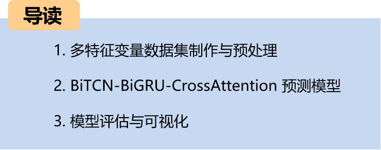
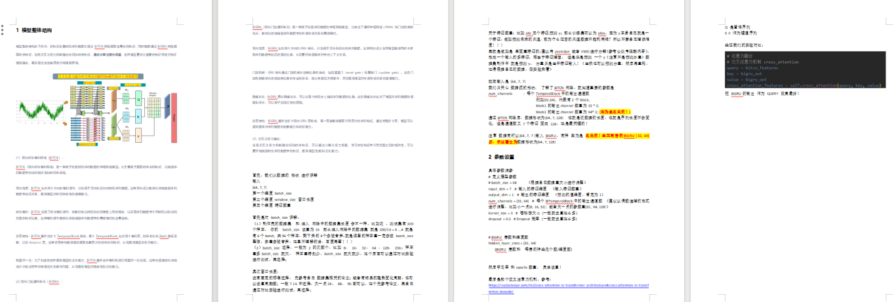
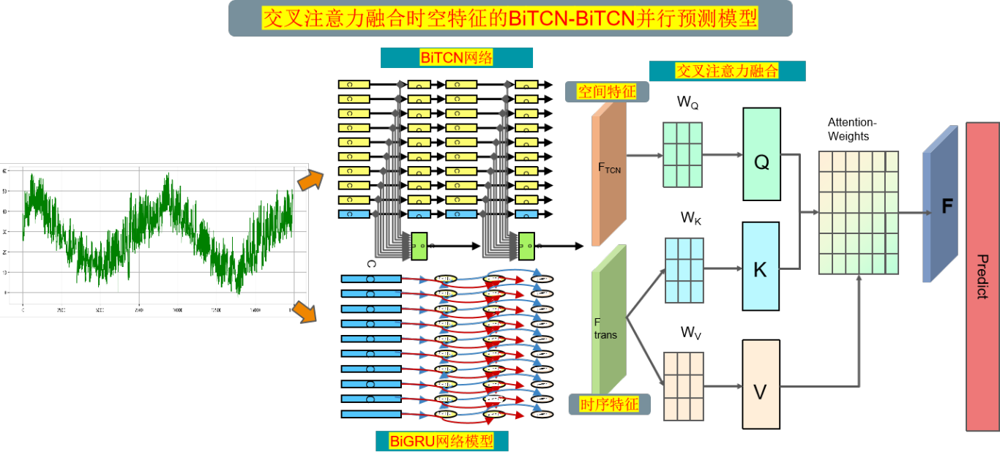
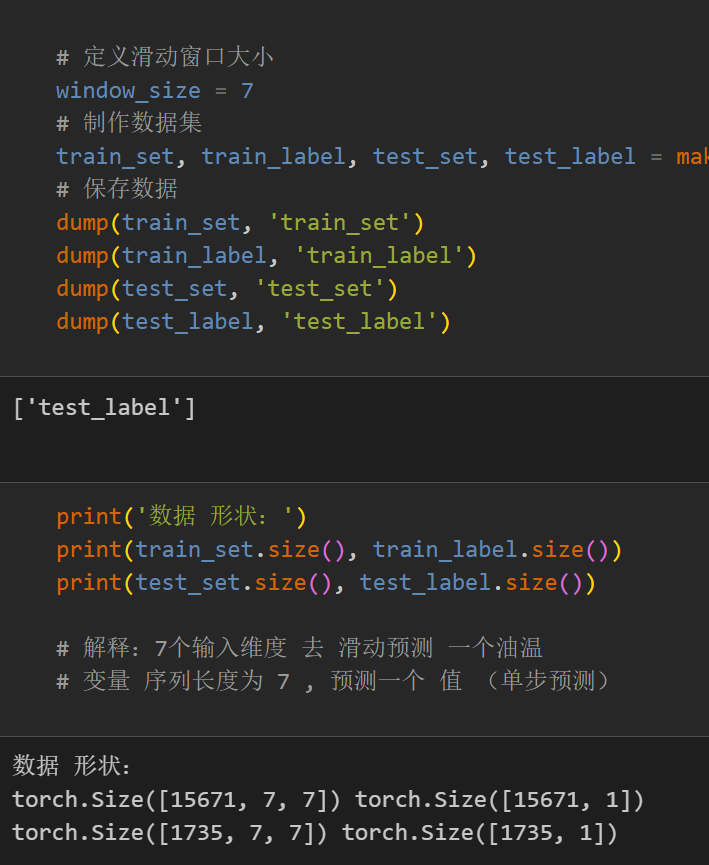
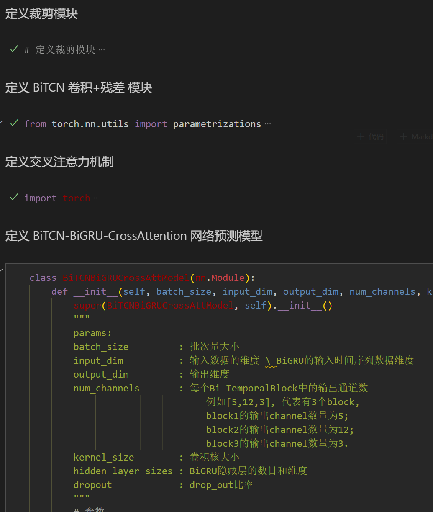
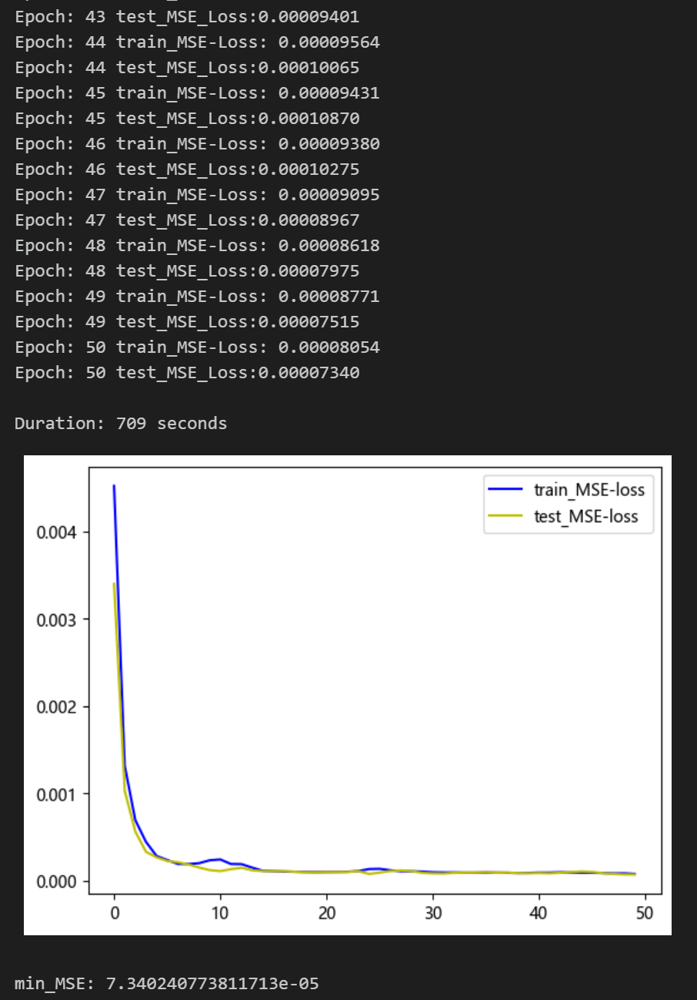
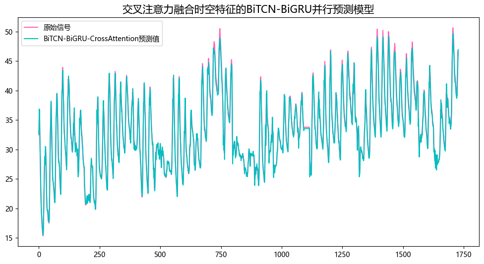
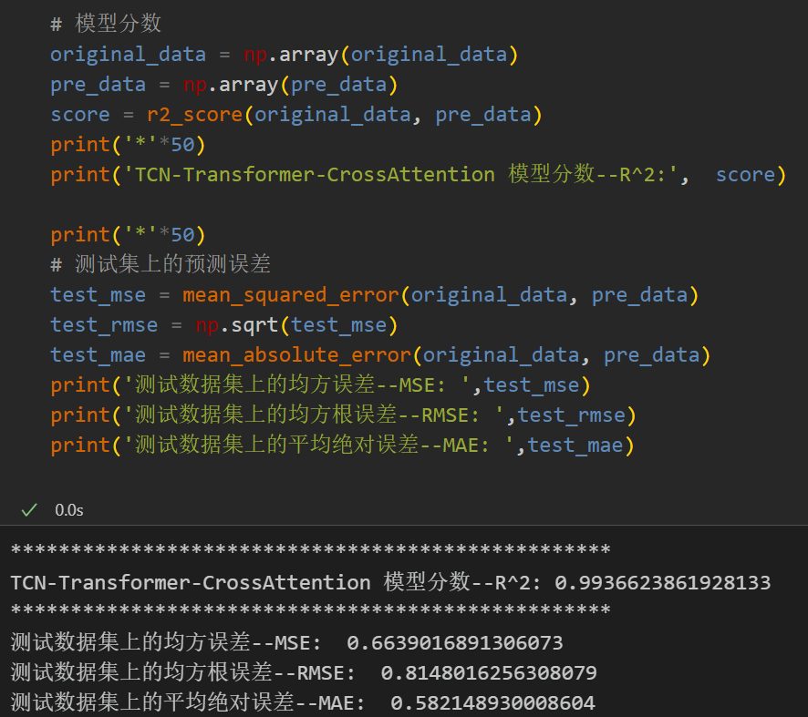
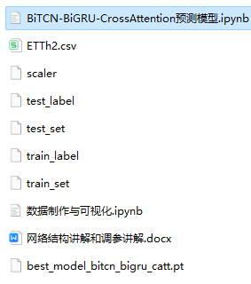

# BiTCN-BiGRU-CrossAttention Fusion Spatiotemporal Features High-Innovative Prediction Model

Environment: Python 3.9, PyTorch 1.8 and above are all acceptable.
Model innovation points, for students who need to complete their graduation projects or publish papers, this is a must-see guide. The model is rich in modules, highly innovative, and performs excellently! Innovation points:
1. BiTCN module: The BiTCN module is used to extract temporal spatial features. The BiTCN consists of multiple TemporalBlocks, each of which contains two convolution layers, batch normalization, ReLU activation function, and dropout layer. Additionally, the BiTCN also applies weight normalization processing to accelerate convergence and improve the generalization ability of the model.
2. BiGRU module: The BiGRU module is used to extract temporal feature. The BiGRU consists of multiple bidirectional GRU layers, which can effectively capture the time-dependent relationship in sequence data, improving the model's ability to model time series.
3. Cross attention mechanism: The cross attention mechanism is introduced to establish connections between the outputs of BiTCN and BiGRU. By calculating query, key, and value, the cross attention mechanism can effectively fuse spatiotemporal features. This allows for considering both temporal and spatial relationships simultaneously, thereby better capturing the features of spatiotemporal sequences, enhancing feature representation capabilities to achieve high-precision predictions.
4. Sequence average pooling and fully connected layer: In the final stage of the model, sequence average pooling operation and fully connected layer are adopted for prediction. Such design can effectively map spatiotemporal features to the prediction result space, thus achieving accurate predictions on sequence data.
Cross attention fusion spatiotemporal features BiTCN-BiGRU parallel prediction model
Note: This product also includes accompanying model explanations and parameter tuning guidance!
Preface
This article introduces a parallel prediction model based on the cross-attention fusion of spatiotemporal features, BiTCN-BiGRU, for enhancing the predictive performance of time series data. The power transformer dataset is introduced in detail at the end of this document:
Power Transformer Dataset Introduction and Preprocessing
The model is applicable to multivariate feature sequences and univariate sequence predictions!
1. Overall Model Architecture
The overall structure of the model is as follows: Multi-feature variable time series data first undergoes extraction of global spatial features through the BiTCN network, while data also extracts temporal features through the BiGRU network. A cross-attention mechanism is used to fuse spatial and temporal features, and attention weights are calculated to focus on important features before feature enhancement and fusion. Finally, high-precision predictions are made through fully connected layers.
(1) Bidirectional SpatioTemporal Convolution Network (BiTCN):
BiTCN (Bidirectional SpatioTemporal Convolution Network) is a neural network model mainly used for processing time series data. It is primarily used to extract temporal spatial feature, capturing the spatial correlation and temporal dependence in the sequence data.
Bidirectionality: BiTCN contains two directions of convolution operations, one for forward and one for backward time series data. This bidirectional design can effectively capture the relationship between the sequence data's previous and subsequent moments, improving the model's ability to model temporal dependencies.
Spatiotemporal Convolution: BiTCN uses spatiotemporal convolution operations, sliding convolution kernels in both time and space dimensions to obtain feature information at different time points and spatial locations in the sequence data. This convolution operation can effectively capture local patterns and global trends in the sequence data.
Multi-layer structure: BiTCN usually consists of multiple TemporalBlocks, each containing two convolution layers, batch normalization, ReLU activation function, and dropout layer. This multi-layer structure can gradually extract abstract level temporal spatial features, thereby improving the model's representation capability.
Weight normalization: To accelerate convergence and enhance the model's generalization capabilities, BiTCN often performs weight normalization on convolutional kernels. This process effectively mitigates the gradient vanishing and exploding problems during training, thereby improving the stability and generalization of the model.
\t  
(2) Bidirectional Gated Recurrent Unit (BiGRU):
\tBiGRU (Bidirectional Gated Recurrent Unit) is a neural network model used for processing sequence data. It combines the advantages of recurrent neural networks (RNN) and gating mechanisms, effectively capturing long-term dependencies and local patterns in sequence data.
Bidirectional nature: The BiGRU includes two GRU units, one for forward and the other for reverse sequence data. This bidirectional design allows the model to consider both the information at the beginning and end of a sequence simultaneously, thereby better understanding the contextual relationships within sequences.
Gated Mechanism: The GRU unit controls the flow of information through gated mechanisms, including reset gates and update gates. These gate mechanisms effectively manage the transmission and retention of information, preventing gradient vanishing or exploding, and enhancing the model's ability to model long-term dependencies.
Hidden States: BiGRUs have hidden states, which can capture the information of sequence data at each time step. These hidden states contain the model's understanding and representation of the sequence data, which can be used for prediction in subsequent tasks.
Multi-layer structure: BiGRU is typically composed of multiple bidirectional GRU layers, each capable of extracting sequence features at different levels. By stacking multiple layers, the model can progressively enhance its abstraction and representation capabilities for sequential data.
(3) Cross Attention Fusion:
\tUsing cross-attention mechanism to fuse spatial and temporal features. The attention weights can be calculated. Learning the correlation between different positions in spatiotemporal features. Can better capture the features in the spatiotemporal sequence data. Improve the model's performance and generalization capabilities.
2. Dataset Preparation and Preprocessing for Multi-feature Variables
2.1 Import Data
2.2 Dataset Production
2.3 Dataset and Classification Labels
3 Cross Attention Mechanism
3.1 Concept of Cross Attention
Cross attention is an attention mechanism that integrates two different embedding sequences in the Transformer architecture. Both sequences must have the same dimensions, and they can be of different patterns (e.g., text, sound, image). One sequence serves as the input for Q, defining the output sequence length, while the other provides input for K&V.
3.2 Cross-attention Algorithm
We have two sequences S1 and S2.
Calculate K and V for S1.
Calculate Q for S2.
Compute the attention matrix based on K and Q.
Apply V to the attention matrix.
The output sequence length matches S2.
During the fusion process, we use the temporal features from the Transformer as the query sequence, and the global spatial features extracted by TCN as the key-value pair sequence. By calculating the attention weights between the query sequence and the key-value pair sequence, we can model the degree of association between different features.
4 Precision Prediction Model Based on BiTCN-BiGRU-CrossAttention
4.1 Define the Network Model
4.2 Set Up Parameters and Train the Model
Training with 50 epochs results in minimal training error, and the multivariate feature BiTCN-BiGRU-CrossAttention integrated network model has a significant prediction effect. The model can fully extract the spatial and temporal features of time series, converges quickly, performs excellently, has high prediction accuracy, and the cross attention mechanism can model the degree of association between different features. It effectively extracts important features for model prediction from the sequence's temporal and spatial characteristics!
4.3 Model Evaluation and Visualization
Prediction Results Visualization
Model Evaluation
Previously interesting content:
Time series forecasting: Analysis and comparison of LSTM, ARIMA, Holt-Winters, SARIMA models
Wind speed prediction (I) Data introduction and preprocessing
Wind speed prediction (II) EMD-LSTM model based on PyTorch
Wind speed prediction (III) EMD-LSTM-Attention model
Wind speed prediction (IV) EMD-Transformer model based on PyTorch
Wind speed prediction (V) EMD-CNN-LSTM model based on PyTorch
Wind speed prediction (VI) EMD-CNN-GRU parallel model based on PyTorch
CEEMDAN + combined forecasting model (BiLSTM-Attention + ARIMA)
CEEMDAN + combined forecasting model (CNN-LSTM + ARIMA)
CEEMDAN + combined forecasting model (Transformer - BiLSTM + ARIMA)
CEEMDAN + combined forecasting model (CNN-Transformer + ARIMA)
Multi-feature variable sequence prediction (I) - CNN-LSTM wind speed prediction model
Multi-feature variable sequence prediction (II) - CNN-LSTM-Attention wind speed prediction model
Multi-feature variable sequence prediction (III) - CNN-Transformer wind speed prediction model
Multi-feature variable sequence prediction (IV) Transformer-BiLSTM wind speed prediction model
Multi-feature variable sequence prediction (V) CEEMDAN+CNN-LSTM wind speed prediction model
Multi-feature variable sequence prediction (VI) CEEMDAN+CNN-Transformer wind speed prediction model
Prediction model based on SSA-SSA optimized algorithm for CEEMDAN-BiLSTM-Attention
Based on the Optimized Algorithm of Sparrows (SSA) for CEEMDAN-Transformer-BiGRU Prediction Model
Superior Prediction Model: Secondary Decomposition-Combination Prediction
Multi-Feature Variable Sequence Prediction (Part 7): CEEMDAN+Transformer-BiLSTM Prediction Model
Multi-Feature Variable Sequence Prediction (Part 8): CEEMDAN-SSA-BiLSTM Prediction Model Based on Sparrows Optimized Algorithm
Multi-Feature Variable Sequence Prediction (Part 11): TCN-GRU Prediction Model Based on Pytorch
VMD + CEEMDAN: Secondary Decomposition, CNN-LSTM Prediction Model
VMD + CEEMDAN: Secondary Decomposition, CNN-Transformer Prediction Model
Prediction Model Based on Sparrows Optimized Algorithm SSA - Complete Code Kit
Superior Combination Prediction Model!
High Innovation | CEEMDAN + SSA-TCN-BiLSTM-Attention Prediction Model
Superior Combination Prediction Model!

## Images

<!-- PAYMENT_BLOCK -->

## Get this dataset

- Payment link (Stripe): [Buy now](https://buy.stripe.com/3cs8yP7sY87d0vu9AB)
- Payment QR code: 

<!-- /PAYMENT_BLOCK -->
